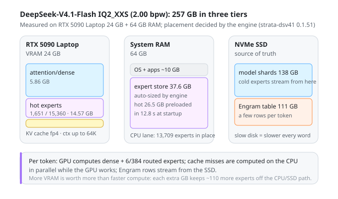
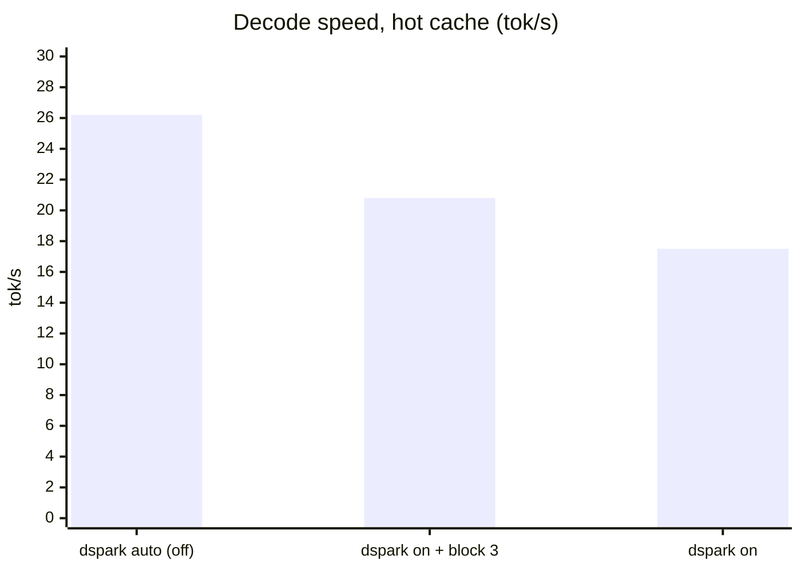
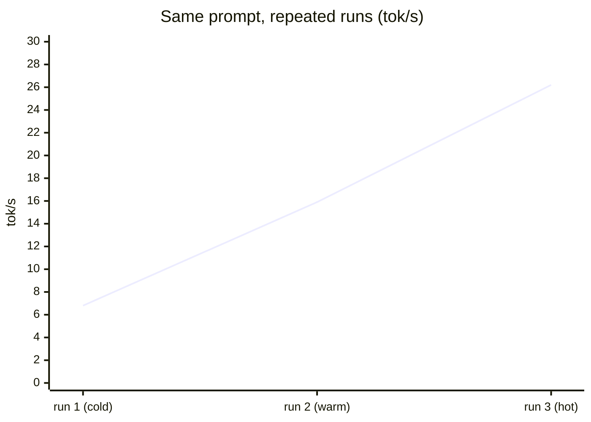
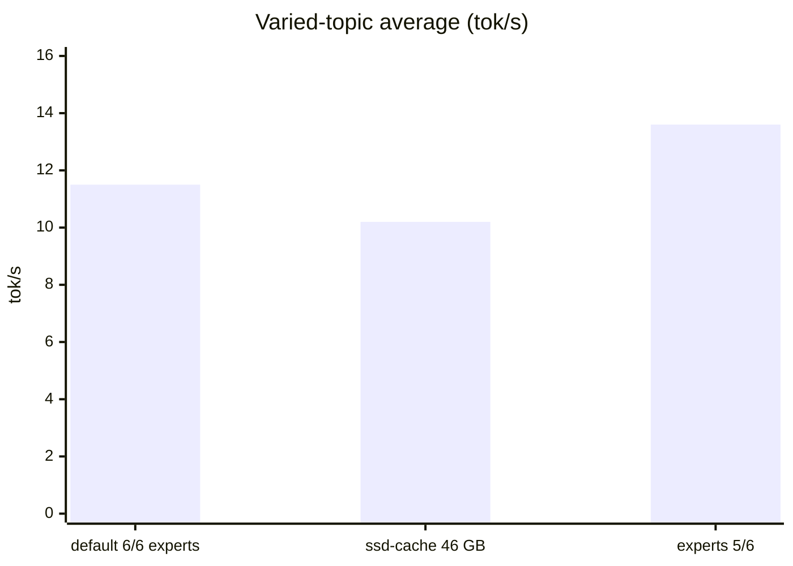

<div align="center">

# DeepSeek-V4.1-Flash on RTX 5090 Laptop (24 GB) + 64 GB RAM

**A 1T-scale MoE running locally on one laptop GPU with [Strata](https://github.com/Niko1221/Strata) — deployment notes, tiering measurements, MTP tuning data.**

[English](#english) · [简体中文](README.zh-CN.md)

</div>

---

Measured on **ISTA-DASLab/DeepSeek-V4.1-Flash-1017-GSQ-RCO-GGUF, IQ2_XXS (2.00 bpw)** with Strata 0.2.6 / strata-dsv41 0.1.51 (cuda13). All speeds are engine-side decode tok/s (`/metrics`), not wall-clock.

| Metric | Result |
|---|---:|
| Decode, same prompt fully cached | **26.2 tok/s** |
| Decode, varied topics (real usage) | **13–16 tok/s** with `--experts 5` |
| Cold start first answer | 6.8 tok/s (4× after cache warm-up) |
| Long-doc prefill, 28,219 tokens | 67.8 s (**≈416 tok/s**) |
| Context | 8K default → **64K verified working** (fp4 KV) |
| Official reference | RTX 5070 12 GB + 64 GB RAM ≈ 4.7 tok/s |

## Model layout — 257 GB in three tiers

The model is a 40-layer MoE with **15,360 routed experts** (6 active per token) plus a 111 GB n-gram table ("Engram"). The engine never "fits" it in memory — it **streams**:



- **VRAM 24 GB**: 5.86 GB dense/attention weights + **1,651 hot experts (14.57 GB)** + fp4 KV cache. VRAM is the scarcest resource: each extra GB keeps ~110 more experts off the CPU/SSD path.
- **RAM 64 GB**: a 37.6 GB expert store auto-sized by the engine; the hottest 26.5 GB preloaded in 12.8 s. The CPU lane computes 13,709 experts **in place from the model files**, in parallel with the GPU.
- **NVMe SSD**: the 138 GB model shards + the 111 GB Engram table, read a few rows per token. **A slow disk slows every word.**

## MTP / speculative decoding: off is fastest

The engine's drafter (DSpark) achieves an 84% acceptance rate here, but it is still a **net loss**: the drafter resides in VRAM and displaces experts, and MoE decode is bottlenecked on expert reads, not compute. `--dspark auto` decides correctly.



| Config | avg (varied) | hot peak | drafts accepted |
|---|---:|---:|---:|
| `--dspark auto` (off) | 11.5 | **26.2** | — |
| `--dspark on --dspark-block 3` | 12.1 | 20.8 | 81% |
| `--dspark on` | 9.8 | 17.5 | 84% |

## Cold → hot: cache warm-up is worth 4×



## Parameter sweep (varied-topic, 600-token outputs)



- **`--experts 5` (Faster)**: +18% — the only lever that actually paid off. Quality cost is officially "usually not noticeable".
- **`--ssd-cache 46000`** (RAM store 46 GB vs auto 37.6 GB): **negative** — cold runs degraded to 4.6 tok/s, memory-pressure suspicion. The auto size is the sweet spot.
- 64K context (`--max-context 65536`): fp4 KV adds ~nothing to VRAM; 28,219-token prefill at 416 tok/s; decode on long context drops to ~6.7 tok/s because the doc evicts hot experts (normal).

## Deployment pitfalls (and fixes)

1. **HF repo updated a file after Strata pinned it** — the 2026-10-25 commit refreshed the GGUF header of `IQ2_XXS-00001` (+11,104 bytes, metadata only, weights identical). Strata 0.2.6's pinned size/SHA rejects the *current official file*. Fix: update the pinned `(size, sha256)` entry in `control/setup.py` to the file's current LFS fingerprint. The file itself is fine — don't re-download.
2. **Built-in downloader 502 through a local proxy** — Strata's Python downloader fails where curl succeeds. Workaround: download DSpark (8 GB) and the 5.8 MB UD-Q8_K_XL metadata shard from a mirror at the pinned revision, drop them into the `--gguf-dir` folder; Strata verifies SHA and accepts them.
3. **The DeepSeek engine ships separately** — `strata-dsv41` is its own signed package. Offline: download `strata-dsv41-<ver>-windows-x86_64-cuda-cuda13.tar.gz` from releases and pass `--dsv41-package`.
4. **Thinking mode is on by default** — for benchmarks/quiet outputs set `"reasoning_effort": "none"`.

## Final configuration

```
strata-dsv41.exe --pack <pack> --max-context 65536 --eos 1 \
                 --dspark auto --dspark-conf 0.65 --experts 5
```

Daily use: run `run-deepseek-v4.1-flash-ist-das-2.00bpw.bat` → chat at `http://127.0.0.1:8080/`. Loading takes 1–3 min (the machine stutters while the RAM store preloads — normal). Closing the window stops the model. Single-request only (parallel is ignored in this version).

APIs: OpenAI-compatible `/v1/chat/completions`, Anthropic-compatible `/v1/messages`; any key, any model name.

## Repository layout

```
configs/   server run configs for every experiment (paths sanitized)
data/      raw /metrics snapshots per experiment (per-request decode, draft stats)
docs/      assets (SVG)
```

## Links

- [Strata](https://github.com/Niko1221/Strata) (MIT) · [Model repo](https://huggingface.co/ISTA-DASLab/DeepSeek-V4.1-Flash-1017-GSQ-RCO-GGUF) · [Strata DeepSeek docs](https://github.com/Niko1221/Strata/blob/main/docs/DEEPSEEK41.md)

Model and engine licenses apply; this repo contains configs, data and text only — no model files.
