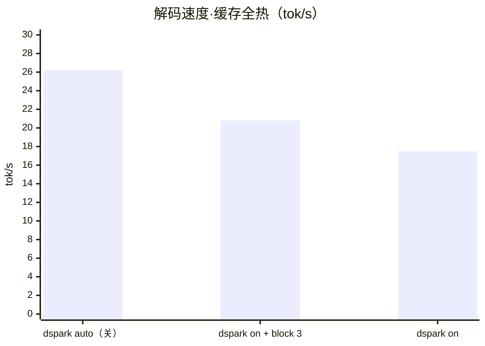
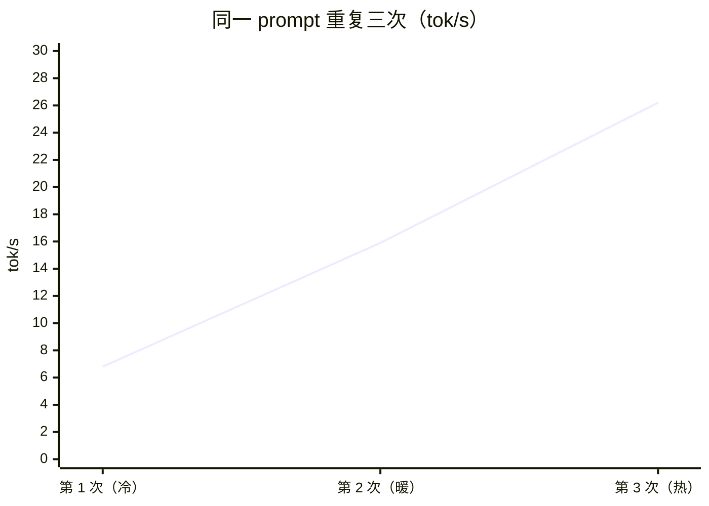
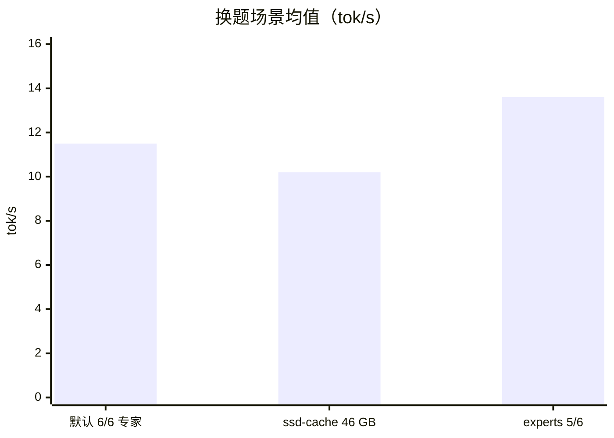

<div align="center">

# DeepSeek-V4.1-Flash 跑在 RTX 5090 笔记本（24 GB）+ 64 GB 内存上

**用 [Strata](https://github.com/Niko1221/Strata) 在单张笔记本 GPU 上本地运行 1T 级 MoE 模型——部署实录、三层资源分配实测、MTP 调优数据。**

[English](README.md) · [简体中文](#中文)

</div>

---

实测模型：**ISTA-DASLab/DeepSeek-V4.1-Flash-1017-GSQ-RCO-GGUF · IQ2_XXS（2.00 bpw）**，Strata 0.2.6 / strata-dsv41 0.1.51（cuda13）。所有速度均为引擎侧 decode 口径（`/metrics`），不是客户端掐表。

| 指标 | 实测值 |
|---|---:|
| 解码（同题缓存全热） | **26.2 tok/s** |
| 解码（换题真实场景） | **13–16 tok/s**（`--experts 5`） |
| 冷启动首个回答 | 6.8 tok/s（缓存预热后翻 4 倍） |
| 长文档 prefill（28,219 tokens） | 67.8 秒（**≈416 tok/s**） |
| 上下文 | 默认 8K → **64K 实测可用**（fp4 KV） |
| 官方参照 | RTX 5070 12 GB + 64 GB 内存 ≈ 4.7 tok/s |

## 模型构成 —— 257 GB 分三层

模型是 40 层 MoE：**15,360 个路由专家**（每个 token 激活 6 个）+ 111 GB 的 n-gram 查找表（Engram）。引擎从不把模型"装进内存"，而是**流式**使用：


- **显存 24 GB**：5.86 GB dense/attention 权重 + **1,651 个热点 experts（14.57 GB）** + fp4 KV cache。显存是最稀缺资源：每多 1 GB ≈ 多驻 ~110 个 experts，CPU/SSD 路径就少算这些。
- **内存 64 GB**：引擎自动定量 37.6 GB 的 expert 存储，启动时 12.8 秒预读最热的 26.5 GB；CPU lane（22 线程 AVX2）从模型文件**原位**并行计算 13,709 个 experts。
- **NVMe SSD**：138 GB 模型分片 + 111 GB Engram 表，每个 token 读几行。**盘慢，每个字都慢。**

## MTP / 投机解码：关着最快

引擎的 drafter（DSpark）在本机接受率高达 84%，但仍是**负优化**：drafter 驻留显存挤占 experts 名额，而 MoE 的 decode 瓶颈在 expert 权重读取、不在算力。`--dspark auto` 的判断是对的。



| 配置 | 换题均值 | 热态峰值 | draft 接受率 |
|---|---:|---:|---:|
| `--dspark auto`（关） | 11.5 | **26.2** | — |
| `--dspark on --dspark-block 3` | 12.1 | 20.8 | 81% |
| `--dspark on` | 9.8 | 17.5 | 84% |

## 冷 → 热：预热值 4 倍



## 参数扫描（换题 600-token 输出）



- **`--experts 5`（Faster）**：+18%——唯一真正见效的杠杆。官方说质量损失通常无感。
- **`--ssd-cache 46000`**（RAM store 46 GB，对比自动 37.6 GB）：**负优化**——冷态掉到 4.6 tok/s，疑似内存压力换页。自动档就是甜点。
- 64K 上下文（`--max-context 65536`）：fp4 KV 显存几乎零增量；28,219 tokens prefill 416 tok/s；长上下文下 decode 降到 ~6.7 tok/s（长文档把热点 experts 全部轮转污染，正常现象）。

## 部署踩坑（及解法）

1. **HF 仓库在 Strata 锚定之后更新过文件**——2026-10-25 的提交刷新了 `IQ2_XXS-00001` 的 GGUF header（多 11,104 字节，仅 metadata，权重不变），而 Strata 0.2.6 的 pinned 尺寸/SHA 校验的是旧版，会拒绝**官方现行文件**。解法：把 `control/setup.py` 里该文件的 `(size, sha256)` 锚定值更新为 HF LFS 当前指纹。文件本身没坏，不要重下。
2. **内置下载器走本地代理必 502**——Strata 的 Python 下载器失败而 curl 正常。绕过：按 pinned revision 从镜像站下载 DSpark（8 GB）和 UD-Q8_K_XL 元数据 shard（5.8 MB），放进 `--gguf-dir` 目录，Strata 校验 SHA 后识别为 "already here"。
3. **DeepSeek 引擎独立分发**——`strata-dsv41` 是独立签名包。离线环境：从 release 页下载 `strata-dsv41-<ver>-windows-x86_64-cuda-cuda13.tar.gz`，用 `--dsv41-package` 交给 setup。
4. **thinking 默认开启**——测速或需要安静输出时设 `"reasoning_effort": "none"`。

## 最终配置

```
strata-dsv41.exe --pack <pack 目录> --max-context 65536 --eos 1 \
                 --dspark auto --dspark-conf 0.65 --experts 5
```

日常使用：双击 `run-deepseek-v4.1-flash-ist-das-2.00bpw.bat` → 浏览器开 `http://127.0.0.1:8080/`。加载 1–3 分钟（RAM store 预热期间机器卡顿属正常）。关窗即停。单并发（此版本忽略并行请求）。

API：OpenAI 兼容 `/v1/chat/completions`、Anthropic 兼容 `/v1/messages`；key 和模型名随便填。

## 仓库结构

```
configs/   每组实验的 server 运行配置（路径已脱敏）
data/      每组实验的原始 /metrics 快照（逐请求 decode、draft 统计）
docs/      图表素材（SVG）
```

## 相关链接

- [Strata](https://github.com/Niko1221/Strata)（MIT）· [模型仓库](https://huggingface.co/ISTA-DASLab/DeepSeek-V4.1-Flash-1017-GSQ-RCO-GGUF) · [Strata DeepSeek 文档](https://github.com/Niko1221/Strata/blob/main/docs/DEEPSEEK41.md)

模型与引擎各自许可适用；本仓库只含配置、数据与文字，不含模型文件。
